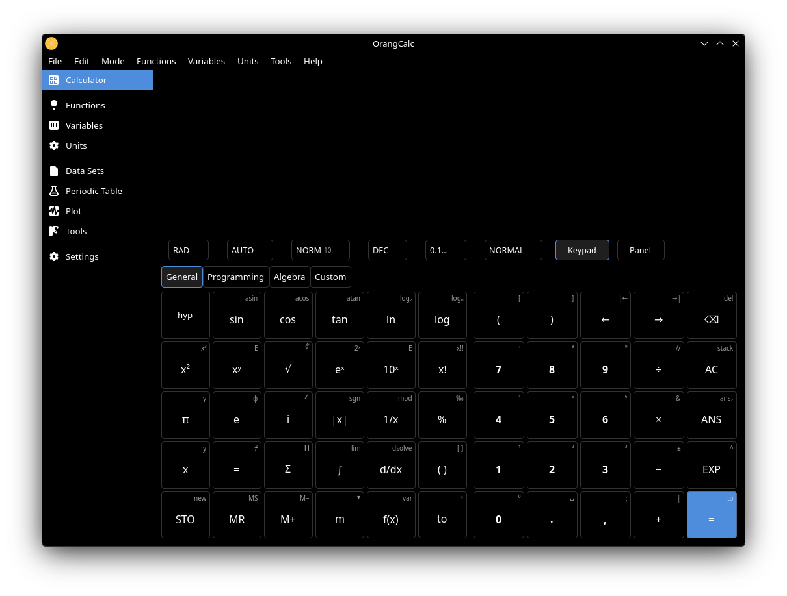

# OrangCalc

**A dark, precise calculator for Linux** - arithmetic, symbolic algebra, units,
currencies, plotting, data sets and a periodic table, all in one desktop app.

Made with love ❤️

---

## The maths

- **340+ built-in functions** - trig & hyperbolics, number theory (gcd, primes, totient,
  partitions, bell, fibonacci), combinatorics, statistics and distributions, special
  functions (Gamma, Erf, Zeta, Bessel, Lambert W, Fresnel…)
- **Matrices & vectors** - determinant, inverse, rank, rref, trace, eigenvalues,
  linear-system solving
- **Intervals & uncertainty** - propagation via `5±0.1` or `interval(4.9, 5.1)` with
  multiple display modes
- **Flexible display** - fractions, scientific/engineering notation, bases from binary
  to sexagesimal, Roman numerals, BCD, and even exotic bases like π, e and golden ratio
- **Flexible input** - hex/bin/octal, dates, fractions (½), uncertainty, complex and
  polar forms, `where x=…` substitutions, `x := value` and `f(x) := expr` definitions

## The interface

- Nine pages: **Calculator, Functions, Variables, Units, Data Sets, Periodic Table,
  Plot, Tools, Settings**
- Dark theme with customizable accent color
- Fully editable keypad with 4 tabs - including a **Custom tab** for your own buttons
- Side panel with History, **RPN stack** and **Number bases**
- Calculate-as-you-type, background abortable calculations, exact approximate toggle
- Workspaces (`.ocws`) that bundle settings, definitions, history and RPN stack
- All keyboard shortcuts rebindable

| Shortcut                                      | Action                   |
|-----------------------------------------------|--------------------------|
| <kbd>Ctrl</kbd>+<kbd>E</kbd>                  | Toggle exact result      |
| <kbd>Ctrl</kbd>+<kbd>R</kbd>                  | Toggle RPN mode          |
| <kbd>Ctrl</kbd>+<kbd>P</kbd>                  | Plot                     |
| <kbd>Ctrl</kbd>+<kbd>Shift</kbd>+<kbd>P</kbd> | Periodic table           |
| <kbd>Ctrl</kbd>+<kbd>S</kbd>                  | Store result as variable |
| <kbd>Ctrl</kbd>+<kbd>Shift</kbd>+<kbd>C</kbd> | Copy result              |
| <kbd>F1</kbd>                                 | Built-in help            |

## Download & run

Grab the latest build from the [**Releases**](https://github.com/Orang-Studio/OrangCalc/releases) page

## License

Released under the [**GNU GPL v3**](LICENSE) © Orang Studio.